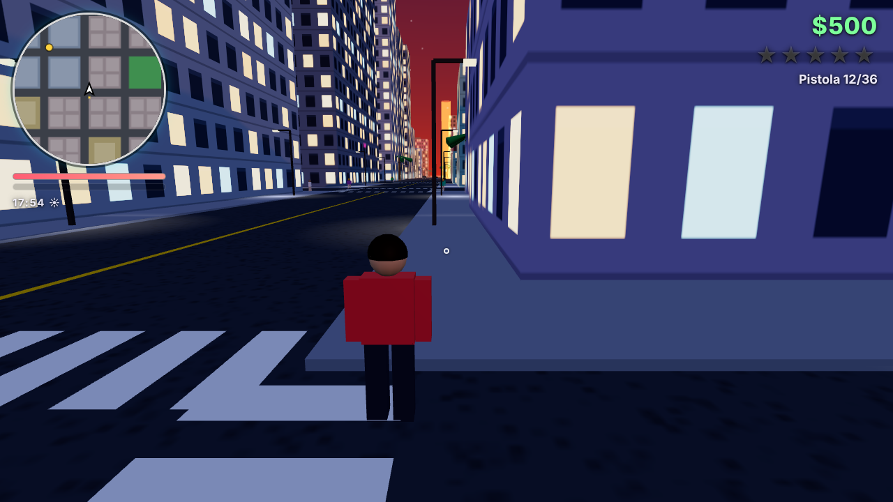
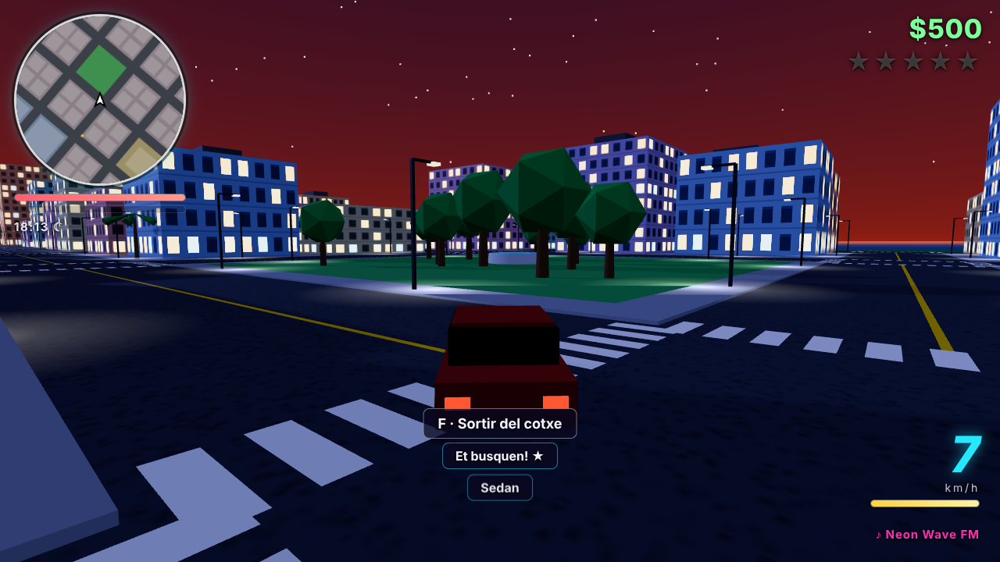
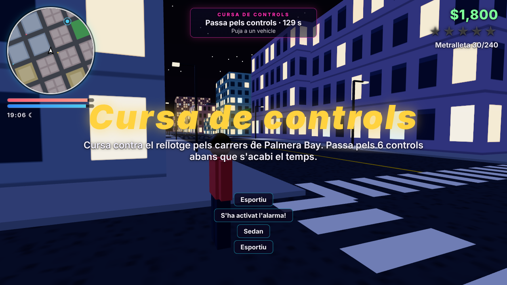

# Palmera Bay

Un joc de món obert **original** per al navegador: una ciutat costanera plena de neó, amb cotxes, policia, armes i missions. Es juga amb ratolí i teclat, sense instal·lar res.

> No és una còpia de cap joc existent: la ciutat, els noms, els personatges, les missions i la música són inventats i generats pel codi.



## Com jugar

1. Descarrega la carpeta `palmera-bay`.
2. Fes doble clic a **`index.html`** (millor amb Chrome o Edge). No cal servidor.
3. Prem **Nova partida**. El navegador captura el ratolí; amb **Esc** fas pausa.

Si vas just de rendiment, tria *Opcions → Qualitat gràfica → Baixa*.

## Controls

| Tecla | Acció |
|---|---|
| `W A S D` | Moure's / conduir |
| Ratolí | Mirar · clic esquerre dispara · clic dret apunta |
| `Shift` · `Espai` | Córrer · saltar (al cotxe: fre de mà per derrapar) |
| `F` | Entrar o sortir d'un vehicle (també es pot robar amb el conductor dins) |
| `R` · `1 2 3` · roda | Recarregar · canviar d'arma |
| `E` | Armeria (a prop de la botiga) · clàxon |
| `N` · `C` | Canviar d'emissora · mirar enrere (al cotxe) |
| `M` | Mapa gran |
| `Esc` | Pausa |

## Què hi ha

- **Ciutat de 700 × 700 m** amb 100 illes: centre amb gratacels, barris residencials, hotels i platja, port amb contenidors, parcs amb font, banc, comissaria, hospital, armeria i garatge. Cicle de dia i nit de 30 minuts amb finestres, rètols de neó i fanals que s'encenen.
- **Conducció arcade** amb sis models de vehicle, derrapatge amb fre de mà, danys, fum, foc i explosions.
- **Trànsit i vianants** que circulen pels carrers i les voreres, frenen davant d'obstacles i fugen dels trets.
- **Policia** amb cerca d'1 a 5 estrelles: cotxes que et persegueixen i et col·lisionen, agents que baixen i disparen, detenció, i la cerca baixa si t'amagues.
- **Armes**: pistola, metralleta i escopeta, amb recàrrega i botiga.
- **5 missions**: robar un cotxe, cursa de controls contra el rellotge, caça d'un fugitiu, atracament al banc i neteja d'una banda. Repetir-les paga el 25 %.
- **Ràdio procedimental** (3 emissores sintètiques), minimapa que gira, mapa gran, pickups, desat automàtic a `localStorage`.




## Per a desenvolupadors

```bash
npm install          # three.js i esbuild
npm run build        # genera dist/game.js (el que carrega index.html)
npm test             # 19 tests unitaris (física, ciutat, IA, cerca, desat)
node tests/browser.test.mjs   # 78 comprovacions al navegador (necessita Playwright)
```

- `src/city.js` · disseny de la ciutat (dades pures, llavor fixa).
- `src/vehicles.js` · física arcade i col·lisions (sense gràfics).
- `src/ai.js` · navegació de trànsit pel graf de carrers i vianants per les voreres.
- `src/world.js` · construcció visual, cel i dia/nit. `src/models.js`, `src/effects.js` · models i efectes.
- `src/player.js`, `src/combat.js`, `src/missions.js`, `src/wanted.js` · jugador, armes, missions i cerca.
- `src/game.js` · bucle principal, població, policia i càmera. `src/hud.js`, `src/audio.js`, `src/main.js`.

## Què s'ha provat i què no

**Provat (automàticament, en un Chromium sense pantalla amb renderitzat per programari):** que el joc carrega des de `file://` sense errors ni avisos a la consola; que es veu de dia, al capvespre i de nit (comprovant píxels); moviment, salt, col·lisions amb edificis, trets, recàrrega, entrar i sortir de cotxes, robar-ne, atropellar, xocar, explotar, policia, detenció, mort i reaparició, botiga, les 5 missions completes i fallides, desar i carregar (també amb un desat corrupte) i pausa. A més, una simulació de **10 minuts de joc amb entrades aleatòries** (36.000 passos) sense errors interns, sense coordenades invàlides, amb el nombre d'entitats acotat i uns 0,3 ms de lògica per pas.

**No provat:** el rendiment real amb una targeta gràfica (només s'ha vist que la lògica és lleugera), el bloqueig del punter i el ratolí reals, el so (és sintètic; només s'ha comprovat que no dona errors), i les sensacions de joc (puntuació dels controls, dificultat, equilibri de les missions). Pot haver-hi errors que només es vegin jugant de debò: si en trobes, digues quin i com es reprodueix.

## Limitacions

És un joc de navegador fet amb formes geomètriques simples, no una producció de gran pressupost. No té multijugador, vehicles aeris ni nàutics, ni interiors enterables. Els personatges són blocs i els cotxes són caixes amb rodes.
